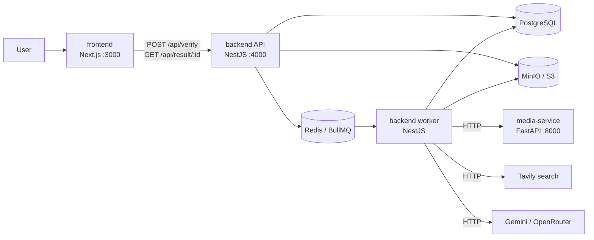

# Veritas AI

**Evidence-backed verification of claims in videos, articles and images.**

Paste a YouTube or news article link, or upload an MP4 or image. Veritas extracts the factual claims it makes, searches trusted sources for each one, and returns a report where every verdict cites the evidence it is based on. The model's own knowledge never counts as evidence.

> ⚠️ Automated verification can be wrong. Always open the cited sources before relying on a verdict.

**Status:** early development (4-week MVP). The monorepo is scaffolded; the pipeline is being built item by item. See [Roadmap](#roadmap).

---

## Contents
- [What it does](#what-it-does)
- [How it works](#how-it-works)
- [Architecture](#architecture)
- [Tech stack](#tech-stack)
- [Repository layout](#repository-layout)
- [Getting started](#getting-started)
- [Scripts](#scripts)
- [Docker images & deployment](#docker-images--deployment)
- [Roadmap](#roadmap)
- [Contributing](#contributing)
- [Documentation](#documentation)

---

## What it does

| Input | How it arrives | Where the text comes from |
|---|---|---|
| YouTube URL | `watch`, `youtu.be`, `shorts` links | Captions, falling back to Whisper transcription |
| News article URL | Any article link | Readability, falling back to Cheerio |
| MP4 video | Upload, ≤ 100 MB, ≤ 15 min | Whisper transcription of the audio track |
| Image | Upload (JPEG / PNG / WebP), ≤ 10 MB | PaddleOCR |

For every check-worthy claim (statistics, dates, events, quotes, scientific and legal statements; not opinions or predictions) the report shows:

- the claim, the original quote and where it appears (timestamp or paragraph)
- a verdict with a confidence score and a short explanation
- the evidence: title, domain, trust tier, date, snippet, and whether it supports or refutes the claim

| Verdict | Meaning |
|---|---|
| 🟢 **Supported** | Evidence clearly supports the claim |
| 🟠 **Misleading** | Partly true, exaggerated, outdated or missing context |
| 🔴 **Refuted** | Evidence clearly contradicts the claim |
| ⚪ **Unverified** | Retrieved evidence doesn't settle it |
| ◌ **Couldn't check** | Processing failed for this claim |

The MVP checks the **text claims inside** content. It does not judge whether an image or video is authentic (no deepfake detection).

## How it works

```
detect → extract → normalize → extract claims → search → rank evidence → verify → report
```

1. **Detect:** the API identifies the input type, checks uploads by their bytes rather than file extension, creates a job and queues it.
2. **Extract:** the worker pulls text from captions, transcripts, the article body or OCR, then cleans and chunks it.
3. **Extract claims:** an LLM picks out up to 10 check-worthy claims, each with a verbatim quote from the source.
4. **Search and rank:** each claim is searched with Tavily, and results are scored by relevance, source trust tier and recency.
5. **Verify:** an LLM judges each claim using only the retrieved evidence. A code-level **VerdictGuard** downgrades any verdict that doesn't cite real evidence to *Unverified*.
6. **Report:** results are assembled deterministically (no LLM) and shown at a shareable, unguessable URL.

Target: **under 60 seconds** end to end for articles, images, captioned YouTube videos and short MP4s.

## Architecture



- The **API is stateless**: it only validates input, stores uploads, creates jobs and reads results.
- All heavy work runs in the **worker**, through BullMQ stage queues (`extract`, `claims`, `verify`, `report`) with one child job per claim.
- The **media service** is in Python because yt-dlp, Whisper and PaddleOCR are Python-native. It scales independently of the Node services.
- LLM, search, media and storage each sit behind an interface, so switching providers means one class plus an env change.

Details: [docs/ARCHITECTURE.md](docs/ARCHITECTURE.md) · [docs/PIPELINE.md](docs/PIPELINE.md)

## Tech stack

| Area | Technology |
|---|---|
| Frontend | Next.js (App Router), TypeScript, Tailwind CSS, TanStack Query |
| Backend | NestJS (API + worker), Prisma, PostgreSQL 16, Redis 7, BullMQ, Zod, pino |
| Media | Python 3.11, FastAPI, yt-dlp, FFmpeg, faster-whisper, PaddleOCR |
| Extraction | jsdom + Mozilla Readability, Cheerio fallback |
| Search | Tavily (with a 24 h Redis cache) |
| LLM | Gemini (default) or OpenRouter, behind an `LlmProvider` interface |
| Storage | MinIO locally, any S3-compatible store in production |
| Tooling | pnpm workspaces, Vitest, oxlint / ESLint, Docker Compose |

## Repository layout

```
ai-fact-checker/
├── frontend/        # @veritas/frontend: Next.js web app (port 3000)
├── backend/         # @veritas/backend: NestJS
│   └── src/
│       ├── main.ts      # HTTP API entrypoint (port 4000, prefix /api)
│       └── worker.ts    # BullMQ worker entrypoint (no HTTP)
├── shared/          # @veritas/shared: Zod schemas + TS types used by frontend and backend
├── media-service/   # Python FastAPI: yt-dlp, FFmpeg, Whisper, OCR (port 8000)
├── docs/            # design docs: the source of truth
└── .claude/         # Claude Code slash commands
```

Each deployable folder builds its own Docker image. See [Docker images & deployment](#docker-images--deployment).

## Getting started

### Prerequisites
- Node.js ≥ 22 and pnpm 10 (`corepack enable`)
- Docker + Docker Compose
- Python 3.11 + [`uv`](https://docs.astral.sh/uv/), only to run the media service outside Docker
- Free API keys: [Tavily](https://tavily.com) and [Gemini](https://aistudio.google.com) (or [OpenRouter](https://openrouter.ai))

### Setup
```bash
git clone git@github.com:ShadyTiger008/ai-fact-checker.git
cd ai-fact-checker
pnpm install
cp .env.example .env      # then fill in the API keys and LLM_MODEL
pnpm dev                  # frontend :3000 · API :4000/api · worker
```

These steps arrive with upcoming roadmap items:
```bash
docker compose up -d                                  # postgres, redis, minio, media (W1-02)
pnpm --filter @veritas/backend prisma migrate dev     # database schema (W1-04)
```

Full guide, environment variables and troubleshooting: [docs/SETUP.md](docs/SETUP.md)

## Scripts

Run from the repo root:

| Command | What it does |
|---|---|
| `pnpm dev` | Builds `shared`, then runs the frontend, API, worker and `shared` in watch mode |
| `pnpm typecheck` | Type-checks every package |
| `pnpm lint` | Lints every package (`any` is a lint error) |
| `pnpm test` | Runs all unit tests (Vitest) |
| `pnpm --filter @veritas/backend test:e2e` | Backend end-to-end tests |
| `pnpm --filter @veritas/backend dev:worker` | Worker only |

`pnpm typecheck && pnpm lint && pnpm test` must pass before any change is considered done.

## Docker images & deployment

Each deployable folder is built and deployed on its own:

| Folder | Image | Runs as |
|---|---|---|
| `frontend/` | `veritas-frontend` | web app |
| `backend/` | `veritas-backend` | **two deployments from one image**: API (`node dist/main.js`) and worker (`node dist/worker.js`) |
| `media-service/` | `veritas-media` | media service |

```bash
docker build -f frontend/Dockerfile -t veritas-frontend .   # repo-root context (needs shared/)
docker build -f backend/Dockerfile  -t veritas-backend .
docker build -t veritas-media media-service
```

The Dockerfiles land in W1-02 (media) and W1-13 (frontend and backend). See [docs/SETUP.md §4](docs/SETUP.md).

## Roadmap

The MVP is planned as four weekly milestones. Each roadmap item is a [GitHub issue](https://github.com/ShadyTiger008/ai-fact-checker/issues), tracked in its [milestone](https://github.com/ShadyTiger008/ai-fact-checker/milestones).

| Week | Focus | Epic |
|---|---|---|
| 1 | Scaffold, API, uploads, frontend shell | [#39](https://github.com/ShadyTiger008/ai-fact-checker/issues/39) |
| 2 | Extraction: YouTube, article, video, image | [#40](https://github.com/ShadyTiger008/ai-fact-checker/issues/40) |
| 3 | Claim extraction and evidence search | [#41](https://github.com/ShadyTiger008/ai-fact-checker/issues/41) |
| 4 | Verification, report UI, evaluation, hardening | [#42](https://github.com/ShadyTiger008/ai-fact-checker/issues/42) |

Item-level progress lives in [docs/ROADMAP.md](docs/ROADMAP.md). Post-MVP ideas (browser extension, PDFs, accounts, deepfake detection, and so on) are parked in [#43](https://github.com/ShadyTiger008/ai-fact-checker/issues/43).

## Contributing

- **Read the docs first.** [`docs/`](docs) is the source of truth, and [CLAUDE.md](CLAUDE.md) lists the rules that are never broken: evidence-only verdicts, extracted content treated as untrusted, Zod-validated LLM output, and every server-side fetch going through `SafeFetch`.
- **One issue = one roadmap item = one commit.** Use [Conventional Commits](https://www.conventionalcommits.org) with the roadmap ID, e.g. `feat(input): W1-07 POST /verify`.
- **Labels:** `area:*` (frontend, backend, worker, media-service, shared, database, infra), `type:*` (feature, chore, test, security, performance, docs) and `module:*` (one per backend module).
- **Definition of done:** checks pass, tests added, ROADMAP item ticked, and any deviation from the docs logged in [docs/DECISIONS.md](docs/DECISIONS.md).

## Documentation

| Topic | Doc |
|---|---|
| Product scope, verdicts, success criteria | [PRD](docs/PRD.md) |
| Processes, modules, queues, security | [Architecture](docs/ARCHITECTURE.md) |
| Each pipeline stage in detail | [Pipeline](docs/PIPELINE.md) |
| LLM prompts and output schemas | [Prompts](docs/PROMPTS.md) |
| Database schema | [Database](docs/DATABASE.md) |
| HTTP API and error codes | [API](docs/API.md) |
| Pages, components, design tokens | [Frontend](docs/FRONTEND.md) |
| Local setup, env vars, Docker | [Setup](docs/SETUP.md) |
| Tests and evaluation | [Testing](docs/TESTING.md) |
| Why things are the way they are | [Decisions](docs/DECISIONS.md) |
| Building this with Claude Code | [Playbook](docs/CLAUDE_CODE_PLAYBOOK.md) |
