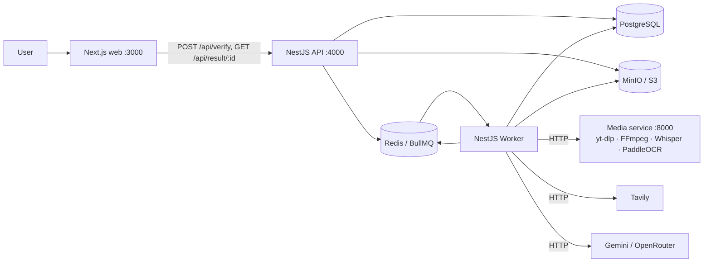
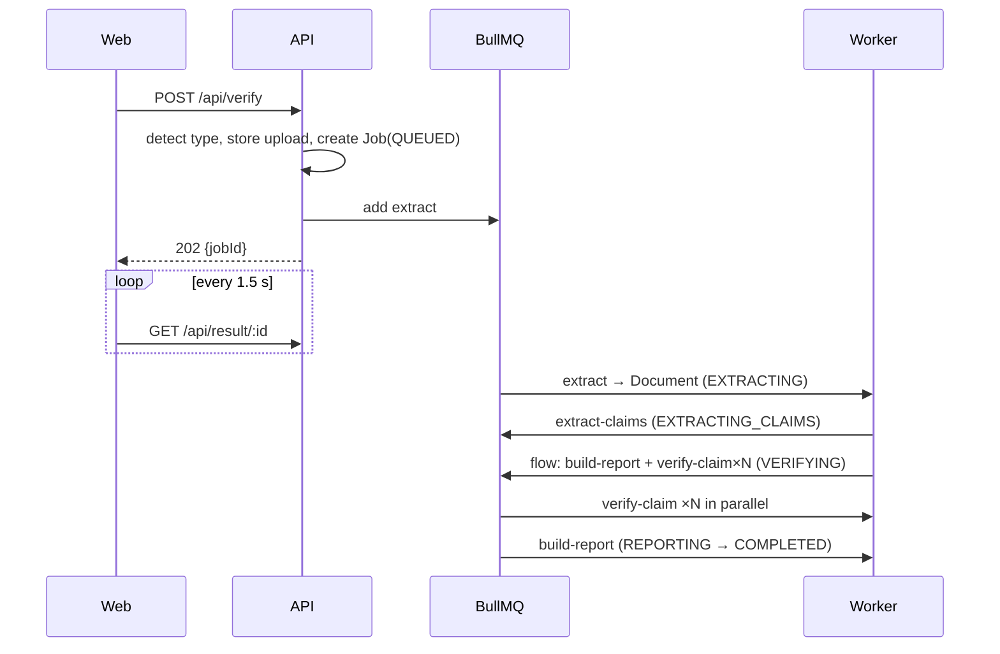

# Architecture

## 1. Processes

| Process | Responsibility | Scales by |
|---|---|---|
| web | UI only, calls API | replicas |
| api | validate input, store upload, create Job, enqueue, read results | replicas (stateless) |
| worker | run pipeline stages | replicas + BullMQ concurrency |
| media | binary/ML-heavy extraction | replicas (CPU/GPU) |

**Code folders → images → deployments** (D-013):

| Folder | Docker image | Deployments |
|---|---|---|
| `frontend/` | `veritas-frontend` | web |
| `backend/` | `veritas-backend` | api (`dist/main.js`) and worker (`dist/worker.js`) — same image, different command |
| `media-service/` | `veritas-media` | media |
| `shared/` | — (bundled into frontend and backend images) | — |

**Why a Python media service:** yt-dlp, Whisper and PaddleOCR are Python-native; isolating them keeps the Node image small, lets media scale independently, and gives a clean HTTP contract. The Nest worker never shells out.

## 2. Nest module map (`backend/src`)
| Module | Owns | Key classes |
|---|---|---|
| `input` | POST /verify, type detection, upload validation | `InputController`, `InputService`, `InputDetector` |
| `extractor` | text extraction + normalization | `ExtractorService`, `YoutubeExtractor`, `ArticleExtractor`, `VideoExtractor`, `ImageExtractor`, `Normalizer`, `ExtractProcessor` |
| `claim` | claim extraction, dedupe, ranking | `ClaimService`, `ClaimProcessor` |
| `search` | Tavily, cache, evidence ranking, trust tiers | `SearchService`, `TavilyClient`, `SearchCache`, `EvidenceRanker`, `trusted-sources.ts` |
| `verification` | LLM verdict per claim + verdict guard | `VerificationService`, `VerdictGuard`, `VerifyClaimProcessor` |
| `report` | GET /result/:id, report assembly | `ReportController`, `ReportService`, `ReportProcessor` |
| infra: `prisma`, `queue`, `storage`, `llm`, `media-client`, `config`, `common` | shared plumbing | `PrismaService`, `StorageService`, `LlmProvider`, `MediaClient`, `SafeFetch`, `AppError`, `mapWithConcurrency` |

Entry points:
- `main.ts` → `AppModule` (controllers + queue **producers** only).
- `worker.ts` → `WorkerModule` (processors only, `NestFactory.createApplicationContext`, no HTTP).

Each module has one job. `search` doesn't know about verdicts; `verification` doesn't call Tavily; it receives evidence from `search`.

## 3. Queues & job flow
Queue names (constants in `queue/queue.constants.ts`):

| Queue | Job | Does | Next |
|---|---|---|---|
| `extract` | `extract` | detect strategy → extract → normalize → save Document | enqueue `claims` |
| `claims` | `extract-claims` | LLM claim extraction → dedupe → save Claims | create **Flow**: parent `build-report` with N children `verify-claim` |
| `verify` | `verify-claim` | search → rank → save Evidence → LLM verify → guard → save Result | (parent runs when all children finish) |
| `report` | `build-report` | aggregate → save `job.report` → COMPLETED | — |

Fan-out uses BullMQ `FlowProducer`. **Child processors never throw after the final attempt**: on terminal failure they persist an `ERROR` result and return normally, so the parent report always runs.

## 4. Job status machine
`QUEUED → EXTRACTING → EXTRACTING_CLAIMS → VERIFYING → REPORTING → COMPLETED`
Any stage → `FAILED` (with `errorCode`, `errorMessage`). Zero claims extracted → skip VERIFYING, go straight to REPORTING with an empty report (not a failure).

Progress (0–100): EXTRACTING 10, EXTRACTING_CLAIMS 30, VERIFYING 30 + 60 × done/total, REPORTING 95, COMPLETED 100.

## 5. Time budget (target ≤ 60 s)
| Stage | Budget | Notes |
|---|---|---|
| Article fetch + Readability | 8 s | SafeFetch timeout |
| YouTube captions | 10 s | Whisper fallback can exceed budget |
| Image OCR | 10 s | |
| Claim extraction | 12 s | chunks in parallel (max 2) |
| Search per claim | 6 s | all claims in parallel (verify concurrency) |
| Verify per claim | 12 s | |
| Report | 1 s | deterministic, no LLM |

Worker concurrency: `verify` queue `VERIFY_CONCURRENCY` (default 4) — tuned to the LLM free-tier RPM.

## 6. Retries & failures
| Failure | Handling |
|---|---|
| Network/5xx to media/Tavily/LLM | BullMQ attempts 3, exponential backoff 2 s |
| LLM 429 | backoff honouring `retry-after`; counts as attempt |
| LLM invalid JSON | one corrective re-prompt, then claim `ERROR` |
| Extraction returns too little text | Job `FAILED` `EXTRACTION_EMPTY` (no retry) |
| Media too long / too large | Job `FAILED` `MEDIA_TOO_LONG` / `FILE_TOO_LARGE` (no retry) |
| Unknown | Job `FAILED` `INTERNAL_ERROR`; log stack with jobId |

Non-retryable errors throw `UnrecoverableError` (BullMQ) so attempts aren't wasted.

## 7. Scalability
Stateless API · background workers · queue-based stages · object storage for uploads · Redis search cache · providers behind interfaces (LLM, search, storage) · media service horizontally scalable · DB indexes on `jobs(status, created_at)`, `claims(job_id)`, `evidence(claim_id)`.

## 8. Security
- SSRF: `SafeFetch` resolves DNS and rejects private ranges (10/8, 172.16/12, 192.168/16, 127/8, 169.254/16, ::1, fc00::/7), re-validates each redirect (max 5), 5 MB body cap, http/https only.
- Uploads: magic-byte sniffing (not extension), size caps, random object keys, presigned GET (5 min) passed to media service.
- Prompt injection: content wrapped in delimiters, system prompt says content is data; outputs schema-validated; verdict guard enforces citations.
- Rate limit: `@nestjs/throttler` 10/min/IP on POST /verify.
- Job IDs are UUIDv4 (unguessable); no listing endpoint.
- Secrets only via env; `.env` git-ignored.
